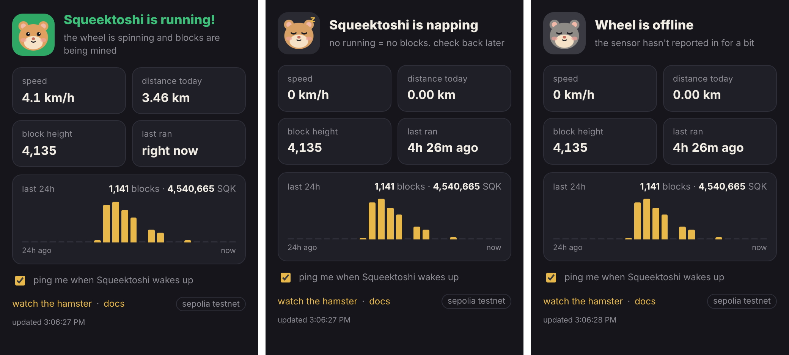

# Squeektoshi Status 🐹

A tiny Chrome extension that answers one question: **is the hamster running?**

[Squeekchain](https://docs.squeekchain.com) is a proof-of-work toychain on Ethereum where a real hamster, Squeektoshi, mines the blocks on his wheel. No running, no blocks. This extension puts his status in your browser toolbar so you always know when the chain is alive.

## What it does

- **Toolbar icon** that changes with the wheel: green when Squeektoshi is running, sleepy when he's napping, grey when the sensor is offline
- **Wake-up ping**: a desktop notification the moment he starts running (you can turn it off)
- **Popup** with live speed, today's distance, block height and when he last ran
- **Last 24h chart** of work per hour, plus blocks completed and SQK issued

## Install (2 minutes)

1. Download this repo: **Code → Download ZIP**, then unzip it
2. Open `chrome://extensions` in Chrome (or Brave / Edge)
3. Turn on **Developer mode** (top right)
4. Click **Load unpacked** and pick the unzipped folder (the one that has `manifest.json` inside)
5. Pin it from the puzzle icon in the toolbar

## How it works

- Reads the public, read-only [Squeekchain API](https://docs.squeekchain.com/developers/api/) (`/v1/status` and `/v1/settlements`) once a minute
- No wallet, no keys, no transactions, no tracking. The only network host it talks to is `api.squeekchain.com`
- Plain JavaScript, no build step, no dependencies

| File | Purpose |
|---|---|
| `manifest.json` | Manifest V3 config and permissions |
| `background.js` | Polls the API every minute, updates the icon and sends the wake-up ping |
| `popup.html` / `popup.css` / `popup.js` | The stats popup |
| `shared.js` | API calls and the running / napping / offline logic |

## Notes

- Squeekchain is currently on the **Sepolia testnet**, so all numbers are testnet data
- "Running" means the wheel sensor reports `ACTIVE` or a speed above zero. "Offline" means the sensor hasn't reported within its freshness window
- Community project, not affiliated with the Squeekchain team

Built by [@OlricOnlyfornft](https://x.com/OlricOnlyfornft). MIT licensed.
